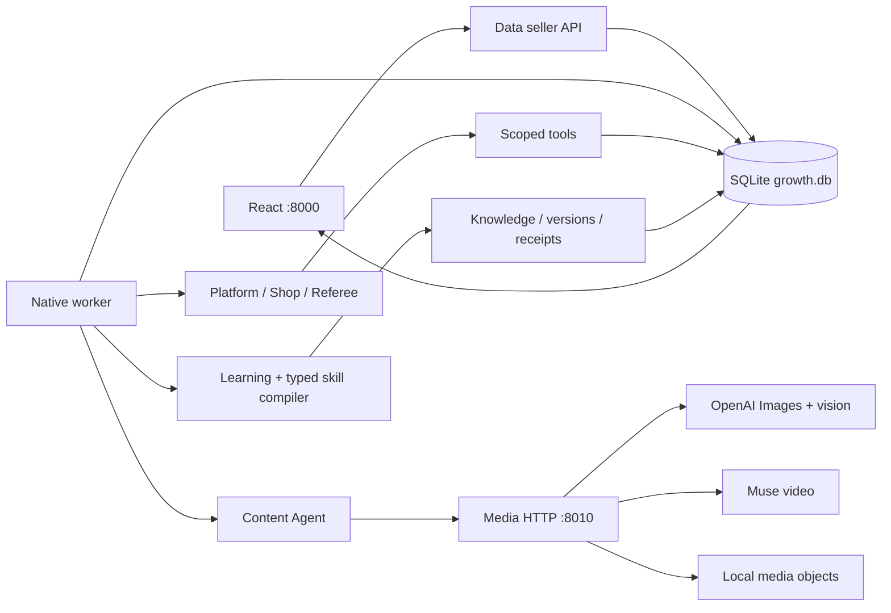

# Tích hợp agent, tools, Knowledge, self-improve, Data và media trên máy local

Ngày 31/10/2026. Bộ này cập nhật phạm vi sau khi Data và media đã được đưa vào `main`. Người dùng yêu cầu **một Astra max review riêng cho mỗi phần**, rồi **Terra 6.1 max implement**. Chế độ Fast không có tham số riêng trong công cụ giao agent.

Đọc [phân công review](REVIEW_ASSIGNMENTS.md), các báo cáo riêng bên dưới, rồi [plan triển khai](IMPLEMENTATION_PLAN.md). Đây là plan của Toàn; chỉ các thay đổi interface dùng chung mới cập nhật tài liệu chung của repo.

| Phần | Review riêng / đầu vào implementation |
| --- | --- |
| Data và DB | [DB_REVIEW.md](DB_REVIEW.md) |
| Agent điều phối | [AGENTS_REVIEW.md](AGENTS_REVIEW.md) |
| Native tools | [TOOLS_REVIEW.md](TOOLS_REVIEW.md) |
| Knowledge | [KNOWLEDGE_REVIEW.md](KNOWLEDGE_REVIEW.md) |
| Self-improve | [SELF_IMPROVE_REVIEW.md](SELF_IMPROVE_REVIEW.md), [SI01–SI07](../self-improve/README.md) |
| Ảnh và video | [MEDIA_REVIEW.md](MEDIA_REVIEW.md), [MI01–MI04](../media-integration/README.md) |
| HTTP API | [API_REVIEW.md](API_REVIEW.md) |
| React UI | [UI_REVIEW.md](UI_REVIEW.md) |
| Chạy local | [HOST_REVIEW.md](HOST_REVIEW.md) |

## Quyết định tích hợp

1. **Data là nguồn business state duy nhất:** run, day, rules, approval, listing, campaign, settlement và event sequence. Dùng SQLite hiện có tại `data/runtime/growth.db`. Không chạy business workflow của `app/runtime/day.py` song song với Data và không dùng `Session.new()` để giả resume một Data run.
2. Agent hiện có tiếp tục dùng native tool calling và LangGraph. Worker lấy context đã bind từ Data, gọi runner thật, persist turn/verdict, rồi Data kiểm và tạo card. Không dùng `HttpHarness` làm agent sản phẩm.
3. Knowledge và self-improve lưu trong **cùng SQLite**. Giữ schema `self-improve.v1`; bổ sung adapter, migration và transaction thật. Những câu trì hoãn DB/`durable NOT_CONNECTED` trong plan cũ được thay bởi phạm vi mới này.
4. Dùng lại `experiment/` qua HTTP cho OpenAI Images và Muse video. Media worker không giữ một listing/approval/campaign riêng trong Session. Bản mới hỗ trợ quạt cầm tay D, logo tùy chọn và nền sáng.
5. Ghép API Data và React trong một app tại `http://127.0.0.1:8000`; media service tại `http://127.0.0.1:8010`. Một worker mỗi process, không reload. Dùng file storage local đã có cho media; không cần dựng thêm MinIO/Postgres/Docker/tunnel cho bản local. MinIO của đồng nghiệp là nguồn đọc để nhập dữ liệu cần thiết, không phải nơi ghi business state của bản này.
6. UI giữ luồng chính: xác nhận brief → thương lượng → seller duyệt → Content/media → chọn ảnh và duyệt/bỏ video → áp dụng → night → ngày sau dùng Knowledge đã học. Review thất bại/không xác định phải được seller xác nhận hoặc bỏ video; không vượt kiểm file và version.
7. Ưu tiên demo shop D trong budget native chung 64. Hết budget thì fallback offline có nhãn thật. Không đánh đồng request model nhận diện thành generation đã chạy hoặc fixture thành bằng chứng live.

## Thứ giữ lại và giới hạn demo

Giữ nguyên validators tiền/privacy, seller approval, native tools, năm ngăn memory, source/evidence và transaction. Không dựng vector DB, auth framework, distributed queue, UI mới, chống spam hoặc bộ máy khôi phục graph tổng quát. Với provider outcome không rõ sau crash, giữ reservation và kết thúc có nhãn unknown/fallback; không tự gọi lại bằng key mới. Replay chỉ được gắn nhãn replay nếu thật sự có record đúng binding/hash.

Acceptance được ghi bằng lệnh và artifact thực chạy trong `IMPLEMENTATION_STATUS.md` sau implementation. Các báo cáo review mô tả baseline và việc cần làm; không phải bằng chứng phần tích hợp đã xong.
