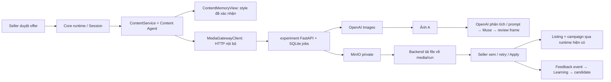

# Hợp nhất media mới vào Agent + Tools + Knowledge

Chốt ngày 31/10/2026. **Đây là plan để agent khác implement, chưa phải báo cáo đã nối xong.** Source media mới từ commit `a0a93f0` đã được đồng bộ vào main local tại `274ce6f`; core Agent/Knowledge giữ nguyên. Các bước dưới thay hướng viết provider trực tiếp trong D05a cũ.

## Kết quả cần đạt

Sau seller accept, `ContentService` thật gọi Content Agent hiện có, dùng HTTP tới `experiment/` tạo ba ảnh OpenAI và một video Muse từ ảnh A. Mọi file về đúng run/card/draft, seller Apply mới publish listing và kích hoạt campaign. Góp ý nền sáng đi vào lần tạo tiếp theo và trở thành candidate để Learning hỏi lại; Rules chỉ đổi sau seller Yes.



`experiment` chỉ sở hữu media job/assets/storage; Session hiện tại sở hữu quyết định, card, Rules và campaign của core demo. Không nối hai nguồn business state bằng cách vừa gọi Data facade accept vừa gọi runtime accept.

## Thông tin mới và quyết định hợp nhất

| Source đã đọc | Sự thật trong source | Quyết định cho demo D |
|---|---|---|
| `experiment/video_api/image_pipeline.py` | 4 style, Images edits nhiều ảnh, JPEG; logo đang bắt buộc | Tái sử dụng; thêm logo tùy chọn, product_kind và background_preference ở MI01 |
| `experiment/video_api/muse_pipeline.py` | Đọc ảnh → viết brief → Muse → kiểm 3 frame → MinIO | Tái sử dụng, mặc định `realistic_human`, 5 giây; video lấy ảnh A cùng draft |
| `experiment/video_api/openai_media.py` | Hardcode quạt để bàn ở prompt và validator | Mở đúng hai loại `handheld_fan`/`desktop_fan`; D gửi handheld, giữ default desktop cho lab cũ |
| `experiment/video_api/main.py` | Bearer riêng, owner, idempotency, upload, job poll, signed URLs | Core gọi JSON job API qua HTTP; browser không giữ service token |
| `experiment/video_api/store.py` | Worker tuần tự; queue 4; job running sau restart thành interrupted | Không tạo thêm queue/framework; gửi A trước, sau A gửi video rồi B/C |
| `app/runtime/day.py` | Apply kiểm file local dưới media/run hoặc replay | Tải media thật về local; không đưa URL hết hạn vào field path để qua gate |
| `app/agents/content.py` | Native Content tool loop và confirmed style đã có | Gọi lại implementation này; media không thay nó bằng GPT riêng của experiment |
| `experiment/CODEX_DEPLOY.md` | Báo đã chạy live 4 JPG và 2 video 5 giây trên máy nguồn | Là thông tin bàn giao, không phải smoke trên máy hiện tại; report/assets ignored chưa có ở checkout |

Hai API đều có tên `/v1/videos` nhưng khác máy và khác body: [CONTRACT](CONTRACT.md) mục 2 phân biệt rõ. Không dùng multipart service body để gọi Muse Gateway trực tiếp.

## Phạm vi agent nhận gói này

**Implement liên tục MI01 → MI04:** sửa media service đúng sản phẩm, client HTTP, ContentService/runtime seam, fixture tests và headless smoke/handoff. Chỉ file trong Output của từng task. Tính năng này không phụ thuộc self-improve đã được implement hay chưa: dùng `generate_content`/`content_view` interface hiện có.

**Data/API/React owner nhận riêng:** [UI_DATA_HANDOFF](UI_DATA_HANDOFF.md). Gói này không tự thay nguồn business state/persistence của Data, không xây lại 9 seller routes và không sửa frontend sang một backend thứ hai. Có thể đạt CORE_MEDIA PASS trước UI_PRODUCT PASS; phải ghi đúng hai trạng thái. Nếu được giao cả facade/UI, thực hiện handoff đó sau khi owner thống nhất transaction; chưa có đầu nối thì không đánh dấu product integrated.

Giữ model/tool/knowledge của Toàn; `experiment` không được nhận ShopPrivate, Persona, fee/cost/profit hoặc memory thô. Text-analysis/prompt/review ở media là bước provider phụ trợ, không thay năm role native tools.

## Thứ tự, thời gian và file cần đọc

Ước lượng cho một coder đã có môi trường; thời gian render/provider và việc cấp key không nằm trong 90–120 phút code. Không đổi tiêu chí hoàn thành để khớp đồng hồ.

| Task | Ước lượng | Đọc / sản phẩm |
|---|---|---|
| [MI01](01-media-service.md) | 20–25 phút | CONTRACT mục 1–4; mở service cho D, optional logo/bright background, metadata/capability |
| [MI02](02-core-client.md) | 20–25 phút | CONTRACT mục 2/5/6; typed HTTP client, config, download/idempotency |
| [MI03](03-content-workflow.md) | 30–40 phút | CONTRACT mục 4–7; ContentService thật, native role, retry/apply/version, worker lifecycle |
| [MI04](04-verification.md) | 20–30 phút | Test flow thật với provider fake, CLI, bàn giao adapter và live gate |

Một người giữ `app/runtime/day.py` và `app/runtime/manager.py` khi ghép. Agent self-improve có thể làm các module riêng của SI01–SI05; ghép các patch runtime của SI06/SI07 tuần tự, đọc source đang có trước mỗi patch. Không copy Session/memory/night hoặc revert thay đổi của người khác để giảm conflict.

## Cấu hình và asset hiện tại

Đã nhập `/Users/butterflyro/Downloads/hello.txt` vào `experiment/.env` local. File cung cấp model/config nhưng key OpenAI và credentials MinIO để trống. Đã dùng lại Muse key local, sinh service token/playback secret, và thêm `MEDIA_API_BASE_URL`/`MEDIA_API_TOKEN` vào `.env` gốc. Hai biến bridge chỉ có tác dụng sau MI02. Cả hai env quyền 0600, được Git ignore; không chép giá trị vào fixtures/docs.

Còn thiếu trước live: `OPENAI_API_KEY`; credentials MinIO đúng server; ảnh thật/synthetic được người dùng chấp thuận của **quạt cầm tay D**. `assets/products/` hiện chưa có ảnh. Logo không còn là blocker sau MI01; không có logo thì prompt không vẽ logo. Root `LLM_MODEL`/key cho native agent vẫn cấu hình riêng; không lấy việc media có key làm bằng chứng agent đã live.

Không tự lấy mẫu quạt để bàn trong experiment để thay SKU D. `experiment/data/`, ảnh/video/reports và DB trên máy nguồn không theo Git. Pipeline thiếu input/config vẫn phải hoàn tất code và tests bằng fake có nhãn, báo live NOT_RUN kèm tên mục thiếu.

## Prompt giao coding agent một lần

```text
Implement gói media-integration theo docs/plans/toan/media-integration/README.md
trên main. Đọc AGENTS.md và source hiện tại; giữ các thay đổi của member/agent khác.
Làm MI01 → MI04 liên tục, theo CONTRACT và Output từng task; tự chuyển task
sau focused tests, không dừng để thiết kế lại các quyết định đã chốt.
Tái sử dụng experiment qua HTTP, không copy hoặc import pipeline vào app.
D là handheld_fan, logo tùy chọn, ba ảnh + video 5 giây realistic_human từ A.
Giữ native Content Agent, facts/privacy, confirmed-style và feedback→Learning.
Giữ seller/version gate, local media validation, cùng request/key khi retry,
không auto-submit provider lần mới khi chưa biết kết quả.
Chạy provider fake trong tests; không gọi paid API để làm xanh test.
Nếu thiếu key/MinIO/ảnh D, vẫn hoàn tất code/core tests và ghi live NOT_RUN.
Không xây lại facade/UI/Data hoặc self-improve; giao các điểm nối theo
UI_DATA_HANDOFF, tách CORE_MEDIA, MEDIA_LIVE và UI_PRODUCT trong báo cáo.
Ghi nhật ký riêng trong docs/plans/toan; commit nhỏ [MI01]…[MI04], chỉ stage
file của task, giữ nguyên bộ self-improve đang có. Bàn giao SHA, test mapping,
log/artifact paths, status nguồn thật và mọi dependency còn thiếu.
```

Reviewer đọc [CONTRACT](CONTRACT.md) và ma trận [MI04](04-verification.md); kiểm caller/runtime thật, không chỉ xem ảnh demo hoặc tên event. Không yêu cầu GPU, local LTX, voice/music mới, 3D renderer riêng, Redis/Celery, chống spam hoặc multiuser cho gói này.
